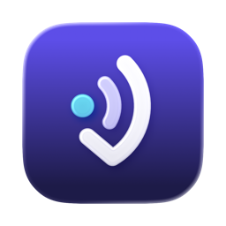
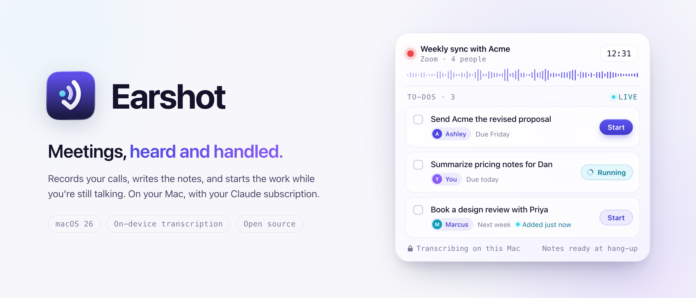
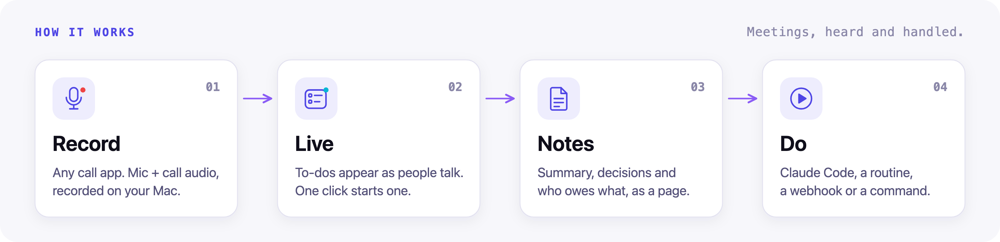
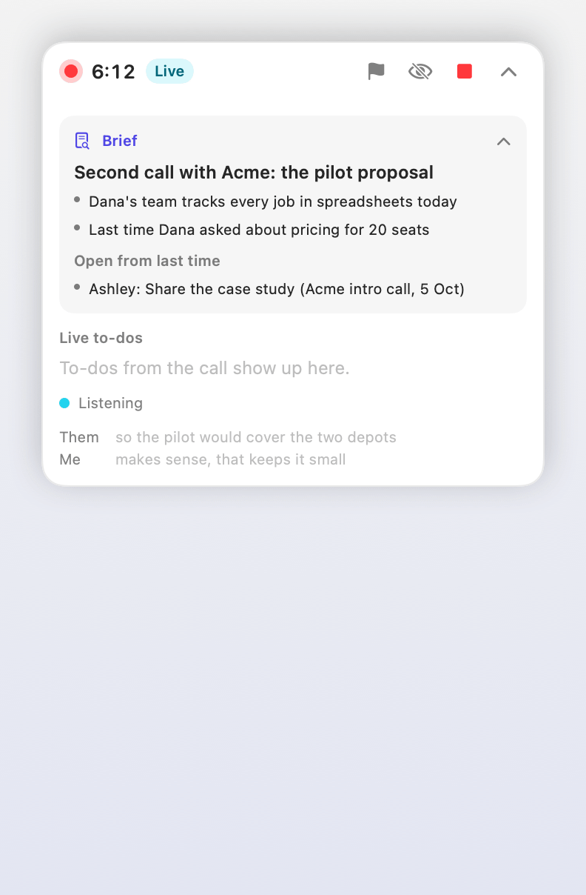
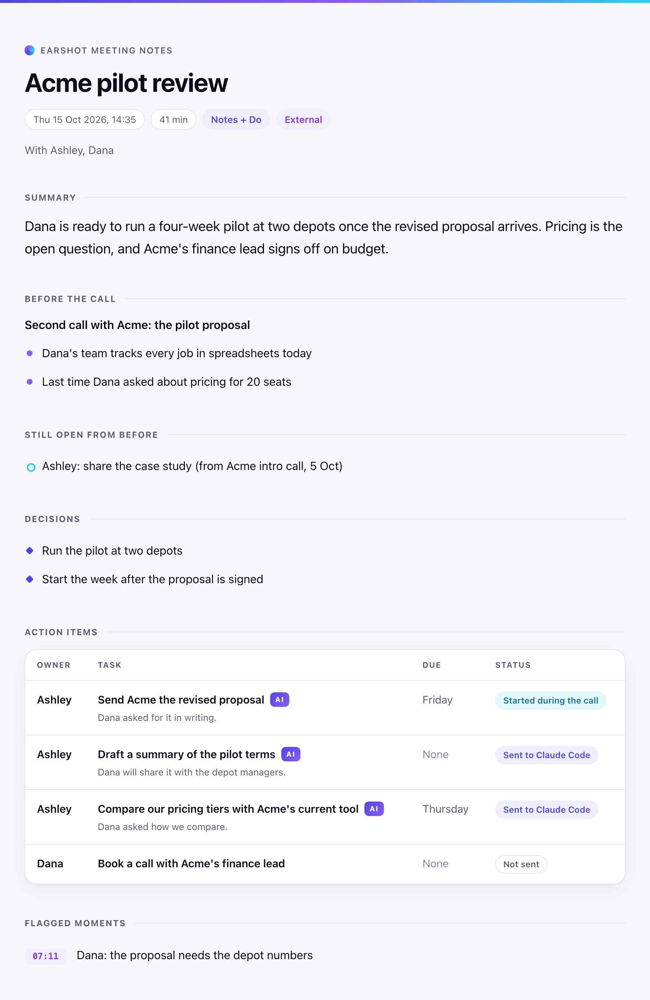
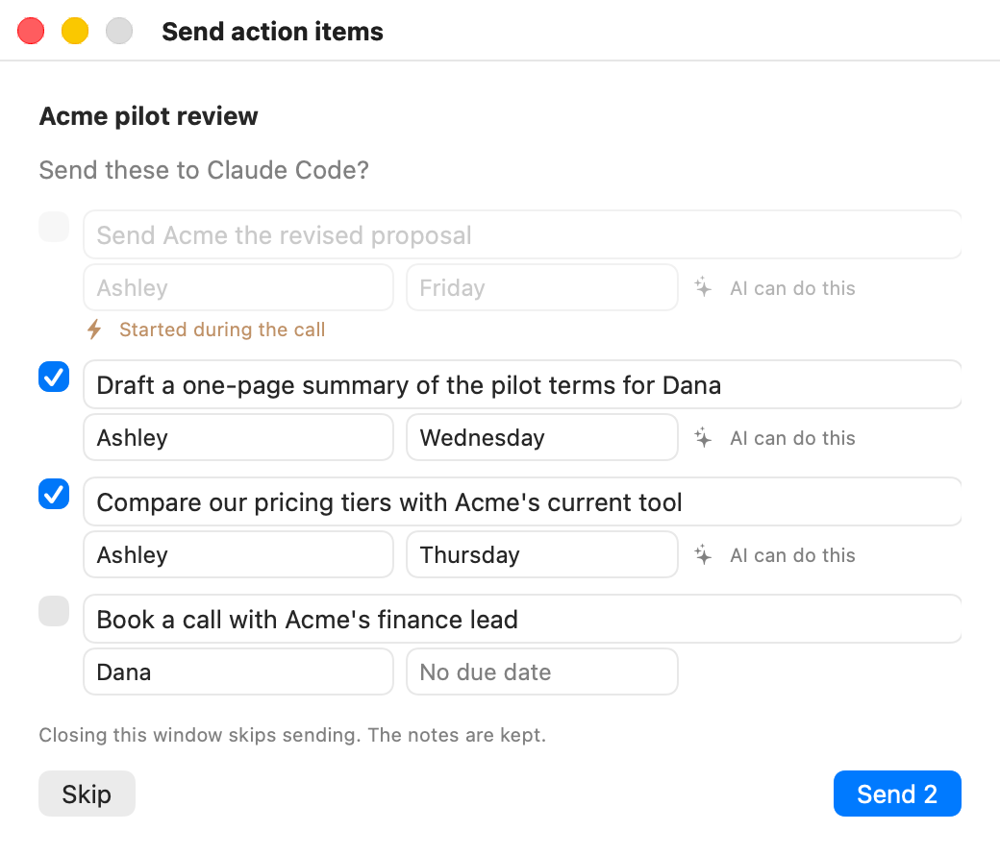

<div align="center">
  
  <h1>Earshot</h1>
  <p><b>Meetings, heard and handled.</b></p>
  <p>A menu bar app for macOS 26 that records any call, transcribes it on your Mac,<br>
  writes notes with Claude or a local model, and puts the to-dos in front of you while the call is still going.</p>

  <a href="https://github.com/stephenlthorn/earshot/actions/workflows/ci.yml"></a>
  <a href="https://github.com/stephenlthorn/earshot/releases/latest"></a>
  <a href="LICENSE"></a>
  
  
</div>

<p align="center">
  <picture>
    <source media="(prefers-color-scheme: dark)" srcset="docs/images/banner-dark.png">
    <source media="(prefers-color-scheme: light)" srcset="docs/images/banner-light.png">
    
  </picture>
</p>

## Why Earshot

- **It works with any call app.** Earshot records what your Mac plays and what your microphone hears. Zoom, Meet, Teams, FaceTime or a browser tab: no bot joins your call.
- **Your audio stays on your Mac.** Apple's on-device speech engine does the transcription. Only text goes to Claude, and only for the features you use. With a local model on your Mac, the notes and every AI feature stay on your Mac too; Do targets you turn on still send the to-dos you confirm.
- **The AI does the work, you make the calls.** To-dos show up during the meeting. Nothing is sent or started until you click, unless you turn off **Ask before sending**. Meetings with people outside your company always ask.

## Features

Pick a mode for each recording: **Record** keeps the audio, **Notes** adds a transcript and notes, and **Notes + Do** also hands the to-dos to the tools you choose.

<table>
<tr>
<td width="50%" valign="top"><b>Live to-dos</b><br>About every 90 seconds, Earshot checks the call for new to-dos and shows them in a small floating panel. In Notes + Do, click Start on one the AI can do, and it can be finished before the call ends.</td>
<td width="50%" valign="top"><b>A brief as the call starts</b><br>With the calendar on, Earshot reads the event and your past meetings with the same people, then shows what's still open from last time.</td>
</tr>
<tr>
<td valign="top"><b>Your AI apps can read your meetings</b><br>An MCP server, an <code>earshot</code> command-line tool and Claude Code plugins let your AI search notes and list who owes what.</td>
<td valign="top"><b>It learns from your edits</b><br>Change a task, owner or due date before you send, or fix the notes, and later notes follow your example.</td>
</tr>
<tr>
<td valign="top"><b>It notices calls</b><br>When a call app turns on your microphone, Earshot offers to record. The calendar picks the mode.</td>
<td valign="top"><b>Flag a moment, ask later</b><br>Press ⌃⌥⌘F, click the flag in the live panel, or say "flag that" with the live assistant on. Afterwards, ask questions about the meeting or tell Earshot what to fix.</td>
</tr>
<tr>
<td valign="top"><b>It can read the shared screen</b><br>Optional and off by default. Earshot reads the text in the call app's window, on your Mac, so "this number here" makes sense in the notes.</td>
<td valign="top"><b>A page for every meeting</b><br>A self-contained HTML page with the summary, decisions, who owes what, a timeline and the full transcript.</td>
</tr>
<tr>
<td colspan="2" valign="top"><b>Runs fully on your Mac if you like</b><br>Write notes, live to-dos, the brief, Ask and Fix with a local model through Ollama, LM Studio or llama.cpp. With the server on your Mac, no account is needed and the meeting never leaves it. <a href="docs/local-models.md">Local models guide</a></td>
</tr>
<tr>
<td colspan="2" valign="top"><b>Do targets</b>: send the to-dos you confirm to <b>Claude Code</b> in a folder you choose (restricted to that folder by default), a <b>Claude Code routine</b> in the cloud, a <b>webhook</b>, or a <b>shell command</b>. Switch on any mix. <a href="docs/do-targets.md">Do targets guide</a></td>
</tr>
</table>

## How it works

<p align="center">
  <picture>
    <source media="(prefers-color-scheme: dark)" srcset="docs/images/how-it-works-dark.png">
    <source media="(prefers-color-scheme: light)" srcset="docs/images/how-it-works-light.png">
    
  </picture>
</p>

1. **Record.** Earshot records two tracks: your microphone ("Me") and the sound your Mac plays ("Them"). Apple's speech engine turns them into text on your Mac.
2. **Live.** With the live assistant on, Earshot transcribes during the call and Claude picks out to-dos as people talk. In Notes + Do, Start hands one to a Do target.
3. **Notes.** After you stop, Claude reads the transcript and writes a title, summary, decisions and action items, each with an owner and a due date if someone said one. They go on a notes page.
4. **Do.** You tick the to-dos to send, edit them if you like, and press Send. They go to Claude Code, a routine, a webhook or a command.

For example, Dana from Acme asks, "Can you send us the revised proposal by Friday?" A minute or two later, "Send Acme the revised proposal (you, due Friday)" sits in the panel with an AI badge. In Notes + Do, one click on Start and Claude Code drafts it in your proposals folder.

## Screenshots

<p align="center">
  
</p>

<table>
<tr>
<td width="50%" align="center">
  <picture>
    <source media="(prefers-color-scheme: dark)" srcset="docs/images/screens/notes-page-dark.png">
    <source media="(prefers-color-scheme: light)" srcset="docs/images/screens/notes-page-light.png">
    
  </picture>
  <br><sub>The notes page</sub>
</td>
<td width="50%" align="center">
  <picture>
    <source media="(prefers-color-scheme: dark)" srcset="docs/images/screens/confirm-dark.png">
    <source media="(prefers-color-scheme: light)" srcset="docs/images/screens/confirm-light.png">
    
  </picture>
  <br><sub>Confirm before anything is sent</sub>
</td>
</tr>
<tr>
<td colspan="2" align="center">
  <picture>
    <source media="(prefers-color-scheme: dark)" srcset="docs/images/screens/settings-local-dark.png">
    <source media="(prefers-color-scheme: light)" srcset="docs/images/screens/settings-local-light.png">
    
  </picture>
  <br><sub>Notes from a local model, fully on your Mac</sub>
</td>
</tr>
</table>

More screens are in the [getting started guide](docs/getting-started.md).

## Install

You need a Mac with **macOS 26 (Tahoe)**. Record mode needs nothing else. For notes, you need Claude Code signed in to your Claude plan, an Anthropic API key, or a local model server (see the next section).

1. Download `Earshot.zip` from the [latest release](https://github.com/stephenlthorn/earshot/releases/latest) and unzip it.
2. Move **Earshot** to your **Applications** folder. The AI apps buttons stay off until you do.
3. Open Earshot once. The build is **not notarized yet**, so macOS blocks it the first time.
4. Open **System Settings > Privacy & Security**, scroll to the message about Earshot, click **Open Anyway** and confirm.
5. Look for the waveform icon in your menu bar. Earshot has no Dock icon.

The setup checklist opens on first launch, and any time from **Settings > General > Setup checklist…**:

- [ ] **Claude.** Earshot shows a status line such as "Signed in to Claude (Max) through Claude Code." **Use an API key** and **Use a local model** switch to the other two options.
- [ ] **Microphone.** Allow it. Pressing Record for the first time also asks.
- [ ] **Call audio.** macOS can't tell an app whether this is allowed, so press **Test**: Earshot plays a short sound and checks it heard it.
- [ ] **Speech model.** Press **Check** to download Apple's on-device speech model now.
- [ ] **Notifications.** They tell you when notes are ready and when a call starts.
- [ ] **Optional.** Calendar, Live assistant, Notice calls and Screen reading are each off until you turn them on.

> [!IMPORTANT]
> Until builds are notarized, macOS treats each update as a new app. After you update, open it with **Open Anyway** again and grant the permissions again.

The full walkthrough is in [Getting started](docs/getting-started.md).

## Choose your AI

Earshot writes notes, live to-dos, the brief, Ask and Fix with one of three. Pick it in **Settings > Claude**, under **Write notes with**.

### Your Claude subscription

Earshot doesn't need an API key. It runs **your own Claude Code** with **your subscription**, the same way you would run `claude` in Terminal.

1. Install Claude Code 2.1.259 or later.
2. Sign in with a Pro, Max, Team or Enterprise plan.
3. Check both from Terminal:

```sh
claude --version
claude auth status
```

What Earshot does and doesn't do:

- It runs the `claude` you installed, unmodified, and Claude Code signs itself in.
- It never reads, stores or passes on your Claude login.
- It builds a clean environment for `claude`, so a stray `ANTHROPIC_API_KEY` in your shell can't switch you to API billing.
- `make claude-test` passed all 15 subscription checks on a Team plan (16 Oct 2026), and `make e2e-import`, where the real app imports a spoken meeting and writes its notes through `claude -p`, has passed on Max and Team plans. `make claude-test` runs the same checks against your own Claude Code. On Pro, onboarding suggests Sonnet for notes and advises leaving the live assistant off.

> [!NOTE]
> Earshot runs your own Claude Code with your subscription. Anthropic's terms may change; an API key is the fully supported route. Earshot is an independent project and is not made or endorsed by Anthropic.

### An API key

Set **Write notes with** to **Claude API key** and paste your key. Earshot keeps it in your Keychain and uses it only for Claude calls.

Details for both are in the [Claude setup guide](docs/claude-setup.md).

### A local model

Set **Write notes with** to **Local model (Ollama, LM Studio, llama.cpp)**, click the button for your server and pick a model. With Ollama:

```sh
ollama pull qwen3:8b
```

With the server on your Mac, the whole meeting stays there, and you need no account. Raise the server's context length first, or long meetings get cut off. The Claude Code Do target and routines still need Claude Code. See the [local models guide](docs/local-models.md).

## Use your meetings in Claude Code

Add the plugin, and Claude Code can search your meetings, read notes and list who owes what. Run these inside Claude Code:

```text
/plugin marketplace add stephenlthorn/earshot
/plugin install earshot@earshot
```

Then ask a question in plain words:

```text
What did Dana say about pricing last week?
```

Want your open to-dos at the start of each Claude Code session? Install the opt-in reminders plugin too:

```text
/plugin install earshot-reminders@earshot
```

You can also connect Claude Code, Claude Desktop or any MCP client from **Settings > AI apps**. For the terminal, press **Copy the install line** in the **Command line** section and paste it into Terminal. Then:

```sh
earshot search "revised proposal"
```

The MCP tools only read. Meeting text reaches the AI marked as quoted content, never as instructions. See the [AI apps guide](docs/ai-apps.md).

## Privacy

Audio and screenshots never leave your Mac. Here is everything that does. With a [local model](docs/local-models.md) running on your Mac, the first item stays on your Mac too:

- **Text to Anthropic, through your Claude Code or your API key** (or to your local model server instead), only for the features you turn on:
  - the transcript, to write notes, answer your questions and fix notes;
  - with the live assistant on, the new transcript plus about a minute before it, about every 90 seconds;
  - with the calendar on, the event title, the agenda (links and dial-in details removed), and attendee names and company domains, never full email addresses;
  - with screen reading on, the text read from the call app's window, with passwords, keys and long numbers removed;
  - with the calendar on, notes from related past meetings, for the brief;
  - up to eight short examples of your past edits.
- **The to-dos you confirm**, to the Do targets you switch on. A routine runs in Anthropic's cloud on your subscription.
- **Meeting text you open in an AI app.** When Claude Code or Claude Desktop reads your meetings through the MCP server or plugins, that app sends what it reads to Anthropic as part of your conversation.
- **The speech model download** from Apple.

Earshot itself sends nothing else. There is no analytics and no telemetry. Record mode sends nothing.

Your meetings live in `~/Documents/Earshot`, one folder each. If iCloud Drive syncs your Documents folder, your meetings sync too. You can move the folder in Settings.

More in [Privacy and consent](docs/privacy-and-consent.md).

## Docs

| Guide | What it covers |
|---|---|
| [Getting started](docs/getting-started.md) | Install, permissions and your first recording |
| [Claude setup](docs/claude-setup.md) | Subscription or API key, models and usage |
| [Local models](docs/local-models.md) | Ollama, LM Studio, llama.cpp: notes without the cloud |
| [Live assistant](docs/live-assistant.md) | The floating panel, live to-dos and Start |
| [Calendar and call detection](docs/calendar-and-calls.md) | Briefs, profiles and recording calls automatically |
| [Flags, ask and fix](docs/flags-ask-fix.md) | Marking moments and improving notes after the call |
| [Screen reading](docs/screen-reading.md) | What is read, what is skipped and what is sent |
| [Do targets](docs/do-targets.md) | Claude Code, routines, webhooks, commands and the payload |
| [AI apps](docs/ai-apps.md) | MCP server, `earshot` CLI and Claude Code plugins |
| [Privacy and consent](docs/privacy-and-consent.md) | What leaves your Mac and how to tell people you're recording |
| [Troubleshooting](docs/troubleshooting.md) | Silent call track, Claude status, permissions |
| [Building from source](docs/building-from-source.md) | Xcode, XcodeGen, tests and signing |
| [Architecture](docs/architecture.md) | How the app, EarshotKit and the helper fit together |
| [MCP reference](docs/dev/mcp.md) | Tools, inputs and protocol details |

## FAQ

**Does it run on Intel Macs?**
Earshot is built as a universal app, for Apple silicon and Intel Macs with macOS 26.

**Is there a Windows or Linux version?**
No. Earshot is built on macOS audio capture and Apple's on-device speech engine, and there are no plans to port it.

**What does it cost?**
Earshot is free and open source. Claude use comes out of your plan's usage limits, or is billed to your API key. A local model costs nothing to run. With the live assistant on at the default interval, an hour of talk uses up to about 40 short live calls, plus the notes call and, with the calendar on, a brief.

**Does my audio leave my Mac?**
No. Transcription happens on your Mac. Only text goes to Claude, as listed under [Privacy](#privacy), or to your local model.

**Can it run without the cloud?**
Yes. Transcription is always on your Mac. Choose a local model in **Settings > Claude**, run it with Ollama, LM Studio or llama.cpp on the same Mac, and notes, live to-dos, the brief, Ask and Fix stay there too. Only the Claude Code Do target and routines still need Claude. See the [local models guide](docs/local-models.md).

**Do I need everyone's consent to record?**
Recording laws differ from place to place, and many require everyone's agreement. When a recording starts, Earshot shows a reminder with a line you can copy into the chat: "Quick heads-up: I'm recording this call so an AI assistant can transcribe it and take notes. I'll share the notes afterwards." You are responsible for recording lawfully.

**Which call apps does it work with?**
Any app that plays sound on your Mac. Call noticing recognises Zoom, Teams, Webex, Slack, Discord, FaceTime, Skype, Tuple and Loom, plus calls in Chrome, Safari, Firefox, Edge, Arc, Brave, Vivaldi and Opera.

**Will people see the panel when I share my screen?**
Earshot tries to hide the panel from screen sharing, but some call apps may still show it. Before you share, press ⌃⌥⌘H (or the eye button in the panel) to shrink it to a small pill that shows only the recording dot and the timer.

**Why does macOS warn me when I open it?**
The build isn't notarized by Apple yet. Use **Open Anyway** in System Settings > Privacy & Security, as described under [Install](#install).

## Building from source

You need Xcode 26 and [XcodeGen](https://github.com/yonaskolb/XcodeGen).

```sh
brew install xcodegen
make test
make run
```

`make run` builds a universal app, signs it ad hoc and opens it. See [Building from source](docs/building-from-source.md) for signing, device tests and `make claude-test`.

## Contributing

Bug reports, ideas and pull requests are welcome. Read [CONTRIBUTING.md](CONTRIBUTING.md) first, and follow the [Code of Conduct](CODE_OF_CONDUCT.md). Please report security issues privately, as described in [SECURITY.md](SECURITY.md).

## License

MIT. See [LICENSE](LICENSE).
