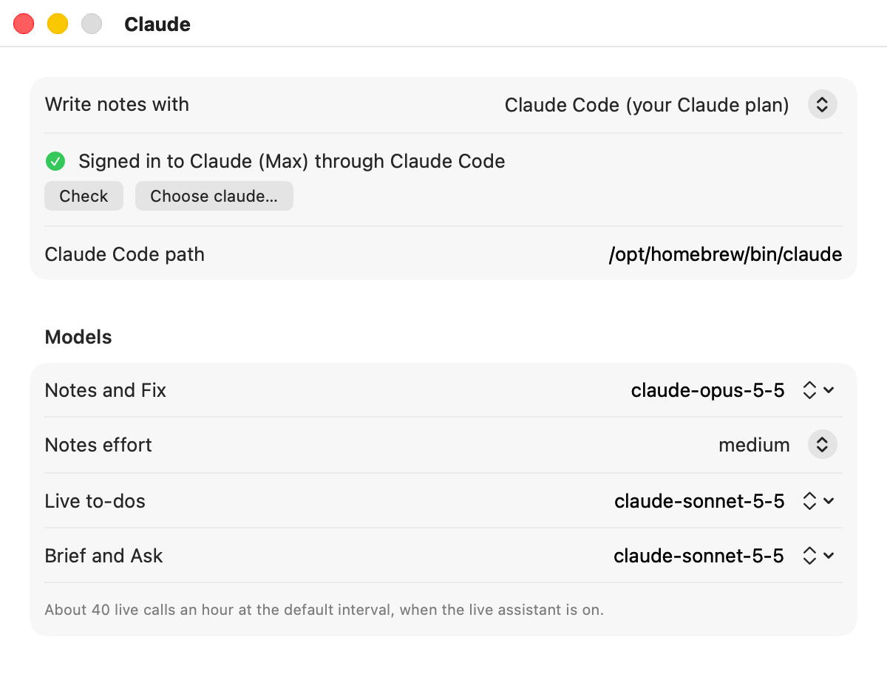

# Claude setup

Earshot uses Claude for notes, live to-dos, the brief, Ask and Fix. This guide shows you how to connect it, what Earshot does with your setup, and how to fix the common problems.

[Back to the README](../README.md)

## Two ways to connect

| | Your Claude subscription | An API key |
|---|---|---|
| **How it works** | Earshot runs your own Claude Code, which signs itself in with your plan | Earshot calls Anthropic's API with a key you paste in |
| **What you pay** | Nothing extra: it draws from your plan's usage limits | Per use, billed to the key's owner |
| **What you need** | Claude Code 2.1.259 or later, signed in with Pro, Max, Team or Enterprise | A key from the Claude Console |
| **Status** | The default for new installs. `make e2e-import` has passed on a Max plan; the full `make claude-test` suite hasn't run yet | The fully supported route |

You can switch between them at any time in **Settings > Claude**. There is a third choice: a local model through Ollama, LM Studio or llama.cpp, which keeps the whole meeting on your Mac and needs no Claude account. See [Local models](local-models.md).

## Please read this first

Earshot runs your own Claude Code with your subscription. Anthropic's terms may change; an API key is the fully supported route.

- Earshot is an independent open-source project. It is not made, reviewed or endorsed by Anthropic.
- On a Max plan, `make e2e-import` has passed: the real app imported a spoken meeting and wrote its notes through `claude -p`, twice. The full `make claude-test` suite hasn't run yet; it runs the checks against your own Claude Code. Subscription mode should work the same on Pro, Team and Enterprise, but those plans haven't been tested.
- Earshot never reads, stores or passes on your Claude login. It never asks for a token from `claude setup-token`. Claude Code signs itself in, exactly as it does when you run it in Terminal.

Here is what Anthropic's [Claude Code legal and compliance page](https://code.claude.com/docs/en/legal-and-compliance) says today, so you can judge for yourself:

- It does not prevent "an end user from signing in to the unmodified Claude Code binary with their own Claude subscription".
- "developers may not collect, store, or intermediate Claude.ai credentials or session tokens". Earshot doesn't.
- Developers building products "should use API key authentication". This is why running your own `claude -p` from an app is a grey area, and why the API key route is always there.

Anthropic's [Help Center](https://support.claude.com/en/articles/15036540-use-the-claude-agent-sdk-with-your-claude-plan) says that `claude -p` and third-party apps can use your subscription limits "for now". If that changes, switch to an API key.

## Use your Claude subscription

### 1. Install Claude Code

Follow Anthropic's [setup guide](https://code.claude.com/docs/en/setup), or run the native installer in Terminal:

```sh
curl -fsSL https://claude.ai/install.sh | bash
```

If you prefer npm:

```sh
npm install -g @anthropic-ai/claude-code
```

Homebrew, npm, nvm, volta and bun installs all work with Earshot.

### 2. Sign in

Run Claude Code once in Terminal and log in with your Claude account when it asks:

```sh
claude
```

Then check the version and the sign-in:

```sh
claude --version
claude auth status
```

`claude --version` should print 2.1.259 or later. `claude auth status` should show `"loggedIn": true` and `"authMethod": "claude.ai"`.

### 3. Point Earshot at it

1. Open **Settings > Claude**.
2. Set **Write notes with** to **Claude Code (your Claude plan)**. New installs start with it.
3. Click **Check** under the status line.

<picture>
  <source media="(prefers-color-scheme: dark)" srcset="images/screens/settings-claude-dark.png">
  
</picture>

Earshot looks for `claude` in these places, in order:

1. the **Claude Code path** field, which **Choose claude…** fills in for you;
2. `~/.local/bin`, `~/.claude/local`, `/opt/homebrew/bin`, `/usr/local/bin`, `~/.npm-global/bin`, `~/.bun/bin` and `~/.volta/bin`;
3. your login shell, by running `whence -p claude` in a non-interactive zsh login shell. If it finds `claude` there, Earshot saves that path in **Claude Code path**, so notes and Do use the same one.

### What the status line means

| Status line | What it means | What to do |
|---|---|---|
| Signed in to Claude (Max) through Claude Code | Everything works. The plan name comes from Claude Code. If Claude Code doesn't name a plan, the line says "Signed in to Claude through Claude Code". | Nothing |
| Claude Code not found | Earshot couldn't find `claude` in any of the places above. | Click **Install**, or click **Choose claude…** and pick it. Or click **Use an API key instead**. |
| Claude Code can't start: … | Earshot found a `claude`, but `claude --version` failed. The line ends with what it printed, or how it ended. | Run `claude --version` in Terminal to see the problem, fix it, then click **Check**. |
| Claude Code 2.1.200 is too old; update it | Earshot needs flags added in 2.1.259. | Run `claude update`, or reinstall, then click **Check**. |
| Claude Code is not signed in: run `claude` in Terminal and log in | You never logged in, or your login expired. | Run `claude` in Terminal and log in. Inside Claude Code, `/login` does the same. |
| Claude Code is set to use an API key, not your subscription | Claude Code itself is set up for a Console API key, so it would bill that key. | Run `claude auth login --claudeai` to sign in with your plan. |
| Claude Code is set to use an API key helper, not your subscription | Your Claude Code settings have an `apiKeyHelper`. | Remove it from `~/.claude/settings.json`, or use the API key route in Earshot. |
| Claude Code is set to use a token, not your subscription | Claude Code is reading a long-lived token instead of your login. | Remove `CLAUDE_CODE_OAUTH_TOKEN` from wherever you set it, then sign in with `claude`. |
| Claude Code is set to use another provider, not your subscription | Claude Code is set up for Bedrock, Vertex or another provider. | Remove that setup, or use the API key route in Earshot. |

Checking runs only `claude --version` and `claude auth status`. It never calls a model and uses none of your plan's usage.

When you press Record in Notes or Notes + Do mode and Earshot can't find `claude` at all, it shows "Claude Code wasn't found. Install it, or set its path in Settings, Claude." The recording still starts, and the notes step waits for **Retry**. Other problems, such as an expired login, show up when the notes step runs.

### Pro, Max, Team and Enterprise

- **Every AI feature** in Earshot runs through the same Claude Code login, and draws from the same usage limits as your own Claude use.
- **On a Pro plan,** onboarding and **Settings > Claude** say: "On a Pro plan, Sonnet is a good choice for notes. Leave the live assistant off so your usage lasts." Onboarding has a **Use Sonnet for notes** button. The live assistant is off until you turn it on, and an hour of it makes about 40 calls.
- **On Max,** the defaults below are what was tested.
- **On Team and Enterprise,** an admin can limit what your account can do. If a model isn't available, Earshot tells you: "Your plan can't use claude-opus-5-5; pick another in Settings".
- **When you hit your usage limit,** the notes step stops with "Your Claude usage limit is reached. Press Retry later." The live assistant pauses for the rest of that meeting. Nothing is lost: press **Retry** on the meeting once your limit resets.

## Models and effort

Earshot uses three models. You can change each one under **Models** in **Settings > Claude**.

| Setting | Used for | Default model | Effort |
|---|---|---|---|
| Notes and Fix | Writing notes, and Fix | claude-opus-5-5 | **Notes effort**, medium by default (low, medium or high) |
| Live to-dos | Live to-dos during the call | claude-sonnet-5-5 | low |
| Brief and Ask | The brief before the call, and Ask | claude-sonnet-5-5 | low for the brief, medium for Ask |

Only the notes effort can be changed. The live model is also in **Settings > Live**, which shows how many live calls an hour uses at the interval you pick: about 40 at the default 90 seconds.

Through Claude Code, Earshot runs at most two of these calls at once, in this order of priority: notes, fix, ask, brief, live. When both slots are busy, a live check is skipped rather than queued. With an API key there is no such limit.

## What Earshot runs, exactly

You're letting an app run a program that is signed in to your account, so here is exactly what it does.

### A clean environment

Every `claude` that Earshot starts gets a fresh environment built from a short allowlist, not a copy of Earshot's own:

- `HOME`, `USER`, `LOGNAME`, `SHELL`, `TMPDIR`, `LANG`, `LC_ALL`, `LC_CTYPE`, `__CF_USER_TEXT_ENCODING`
- `PATH`, which Earshot builds so Homebrew, npm, nvm, volta and bun installs work.
- `CLAUDE_CONFIG_DIR`, only when it is already set where Earshot was started. It is a folder, not a login, and Claude Code needs it to find your login when you keep its config somewhere else. `earshot doctor` also looks for the Earshot plugin there.

Nothing else gets through. So if your shell exports `ANTHROPIC_API_KEY`, `ANTHROPIC_AUTH_TOKEN`, `CLAUDE_CODE_OAUTH_TOKEN` or a provider switch, Earshot's `claude` never sees it, and uses your subscription login instead of billing a key by accident.

Earshot also never:

- sets `CLAUDE_CONFIG_DIR` itself, which would lose your login (yours is passed on unchanged);
- passes `--bare`, which skips the subscription login;
- quietly retries without a flag your Claude Code rejected. An "unknown option" error means your Claude Code is too old.

### The call for notes and every other AI feature

```
claude -p --output-format json --json-schema <schema>
  --system-prompt-file <tmp>/system.txt --tools "" --strict-mcp-config
  --safe-mode --restricted --permission-mode dontAsk --permission-prompts none
  --no-session-persistence --model <model> --effort <effort>
```

What that means in plain words:

- It runs in a new temporary folder that holds only the system prompt file, and the folder is removed afterwards. The rest of the prompt goes on standard input.
- `--tools ""` gives Claude no tools. It can only write the answer.
- `--safe-mode` and `--strict-mcp-config` stop your own Claude Code setup from loading: no hooks, plugins, MCP servers, skills or CLAUDE.md files.
- `--restricted` and `--permission-mode dontAsk` deny anything that would need approval.
- `--no-session-persistence` means no session is saved to your Claude Code history.
- The answer must match a fixed JSON shape, which Earshot checks.

In these calls, meeting text always reaches Claude inside labelled tags, with the rule that everything inside them is information from the meeting, never an instruction.

### The Claude Code Do target

When you send action items to Claude Code, Earshot runs it in the folder you chose. In the default **restricted** mode, it can read and edit files in that folder and nothing else:

```
claude -p --restricted --permission-mode acceptEdits --tools Read,Edit,Write,Glob,Grep
  --permission-prompts none --strict-mcp-config --disallowedTools "mcp__*"
  --no-session-persistence --output-format json
```

In the other permission modes (Edit files, Auto, Everything, no prompts) Earshot runs `claude -p --permission-mode <mode> --output-format text` with your normal Claude Code setup, and the run is saved in your Claude Code history.

If Claude Code was refused anything, such as a write outside the folder, the send counts as failed. The meeting shows "Partly done. Denied:" and the paths, and `do-claude-code.log` lists them too. See [Do targets](do-targets.md) for the other modes and the routine target.

## Use an API key

An API key is the route Anthropic supports for apps like Earshot. Use it if you don't have Claude Code, if you'd rather keep your plan's limits for yourself, or if subscription mode ever stops working.

1. Create a key in the Claude Console.
2. Open **Settings > Claude** and set **Write notes with** to **Claude API key**. When the Claude Code status line shows a problem, **Use an API key instead** does the same.
3. Paste the key into **Anthropic API key**. It is saved as you type.

Earshot doesn't test the key when you paste it. If it is wrong, the first call fails with "Anthropic rejected the API key. Check it in Settings, Claude."

The key is kept in your Mac's Keychain. Earshot never writes it to its settings, your meeting folders or its logs.

With an API key, notes, live to-dos, the brief, Ask and Fix call Anthropic's API directly. The Claude Code Do target still runs your Claude Code with its own sign-in.

**For the `earshot` command-line tool,** set the key in your environment:

```sh
export ANTHROPIC_API_KEY=sk-ant-...
earshot process ~/Desktop/acme-call.m4a --title "Acme kickoff"
```

### Max and Team API credits

Max and Team plans now include monthly API credits, which can pay for an API key:

- Max 5x: $100 a month. Max 20x: $200 a month.
- Team: $20 or $100 per seat, pooled, up to $500.

The credits go to a Claude Console organization linked to your plan. Any API key in that organization draws from them. They don't cover interactive Claude Code, and they aren't used when Earshot runs through your subscription. See Anthropic's [article on monthly API credits](https://support.claude.com/en/articles/17154008-monthly-api-credits-for-max-and-team-plans) for how to link the organization.

## Checking it yourself

This command checks your Claude setup along with everything else:

```sh
earshot doctor
```

With Claude Code, its **Claude** line is the same status line Settings shows, plus the path it used. With an API key, it checks that `ANTHROPIC_API_KEY` is set. With a local model, its first line is **Local model**, the status line from Settings. None of these checks calls a model.

## Troubleshooting

**Notes failed and the meeting shows Retry.** Open **Settings > Claude** and click **Check**. Fix whatever the status line says, then press **Retry** on the meeting. Your recording and transcript are safe.

**Claude Code works in Terminal but Earshot says it's not found.** Apps opened from Finder don't see your shell's `PATH`. Earshot asks a login shell, but that shell doesn't read `~/.zshrc`, where nvm and some installers set `PATH`. Click **Choose claude…** and pick the file. To find it, run:

```sh
whence -p claude
```

**Earshot says "not signed in" but Terminal works.** Your login may have expired. Run `claude` and log in again, then click **Check**.

**Claude Code bills my API key instead of my plan.** That happens in Terminal when `ANTHROPIC_API_KEY` is set, but never inside Earshot, which removes it. If Earshot's status line says an API key is in use, Claude Code itself was signed in with a Console account. Run:

```sh
claude auth login --claudeai
```

**"Your plan can't use <model>".** Pick another model for that role in **Settings > Claude**. On Pro, Sonnet is the suggested model for notes.

**"Paused: Claude usage limit" in the live panel.** The live assistant stops for the rest of the meeting and doesn't retry. Recording carries on. The notes step runs as usual and asks for **Retry** if the limit still applies. "Paused: Claude Code is not signed in" works the same way.

**It stopped working after a Claude Code update.** Anthropic has said that `--bare` will become the default for `claude -p` in a future release, and bare mode doesn't use your subscription login. If that happens before Earshot is updated, switch to an API key and [open an issue](https://github.com/stephenlthorn/earshot/issues).

More fixes in [Troubleshooting](troubleshooting.md).
