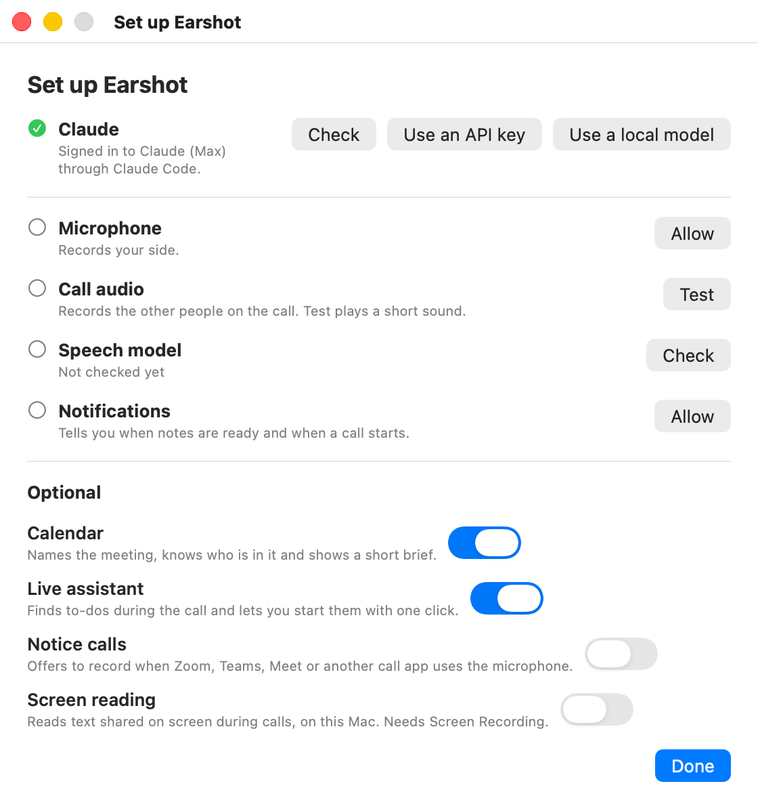
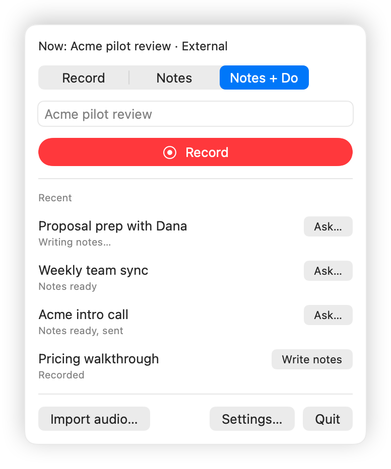

# Getting started

This guide takes you from download to your first set of meeting notes. It takes about ten minutes, most of it granting permissions.

Earshot is a menu bar app for macOS 26 (Tahoe). It records what your microphone hears and what your Mac plays, so it works with any call app: Zoom, Google Meet, Teams, FaceTime, Slack huddles or a call in a browser tab. It transcribes on your Mac, then writes notes with Claude.

[Back to the README](../README.md)

## What you need

- A Mac running macOS 26 (Tahoe), Apple silicon or Intel.
- For notes and the AI features, one of these:
  - Claude Code 2.1.259 or later, signed in with a Claude Pro, Max, Team or Enterprise plan. See [Claude setup](claude-setup.md).
  - An Anthropic API key.
  - A local model server on your Mac, such as Ollama, LM Studio or llama.cpp. See [Local models](local-models.md).
- Record mode needs none of them. You can record today and set up Claude later.

## Install

1. Download `Earshot.zip` from the [latest release](https://github.com/stephenlthorn/earshot/releases/latest).
2. Unzip it and move **Earshot** to your **Applications** folder. Do this before you open it. Some features, such as "Add to Claude Code", only work once Earshot runs from Applications.
3. Open Earshot. macOS blocks it the first time, because the build is not notarized yet.
4. Open **System Settings > Privacy & Security**, scroll down to the message about Earshot, click **Open Anyway** and confirm.
5. Look for the waveform icon in your menu bar. Earshot has no Dock icon.

> [!NOTE]
> Until builds are notarized, macOS treats each update as a new app. After you install an update, you have to grant the permissions again: microphone, call audio, and any others you turned on.

### Updating

Quit Earshot, replace the app in Applications with the new one, and open it. Use **Open Anyway** again if macOS asks. Your meetings and settings stay where they are, and meetings recorded with an older version open unchanged.

If you used an earlier version, a "New in Earshot 0.3" window appears once. It lists what's new (writing notes with a local model) and what 0.2 added, shows your Claude status, and lists the optional features, each switched off until you turn it on. If you already used an API key for notes, Earshot keeps using it.

## The setup checklist

The setup checklist, titled "Set up Earshot", opens on first launch. You can open it again any time from **Settings > General > Setup checklist…**. The top rows have buttons that grant a permission or run a check, and each gets a green tick once it works. The optional features below them are switches.

<picture>
  <source media="(prefers-color-scheme: dark)" srcset="images/screens/onboarding-dark.png">
  
</picture>

| Row | What it does | Needed for |
|---|---|---|
| **Claude** | Shows whether Earshot can reach Claude, for example "Signed in to Claude (Max) through Claude Code." **Check** looks again. **Use an API key** switches to a key instead, and **Use a local model** to a local model. With a local model, the row is called **Local model**, shows the server's status, and **Set up** opens **Settings > Claude**. | Notes and every AI feature |
| **Microphone** | Records your side of the call. Click **Allow**. | Every recording |
| **Call audio** | Records the other people. macOS can't tell an app whether this permission is on, so **Test** plays a short sound and checks that Earshot heard it. | Every recording |
| **Speech model** | Apple's on-device speech engine needs a model for your language. **Check** downloads it now. | Transcripts and notes |
| **Notifications** | Tells you when notes are ready and when a call starts. Click **Allow**. | Optional |
| **Calendar** | Names the meeting, knows who is in it and shows a short brief. Off until you turn it on. | Optional |
| **Live assistant** | Finds to-dos during the call and lets you start the ones an AI can do with one click. Off until you turn it on. | Optional |
| **Notice calls** | Offers to record when Zoom, Teams, Meet or another call app uses the microphone. Off until you turn it on. | Optional |
| **Screen reading** | Reads text shared on screen during calls, on this Mac. Needs Screen Recording permission. Off until you turn it on. | Optional |

On a Pro plan, the Claude row also suggests Sonnet for notes and advises leaving the live assistant off, so your usage lasts.

**If the call audio test fails,** check that your Mac isn't muted (the test has to hear the sound). Then allow Earshot under **System Settings > Privacy & Security > Screen & System Audio Recording** and test again. If you skip this, Earshot records silence on the call track without any error. A recording whose call track was completely silent gets a warning after you stop.

**If you skip the speech model,** the first transcription downloads it instead.

Press **Done** when you have finished.

The optional rows each have their own guide:

- [Calendar and calls](calendar-and-calls.md)
- [Live assistant](live-assistant.md)
- [Screen reading](screen-reading.md)

## The three modes

You pick a mode for each recording in the menu bar panel.

| Mode | What happens after you press Stop | Needs Claude |
|---|---|---|
| **Record** | The audio is saved. Nothing else happens. | No |
| **Notes** | Earshot transcribes the audio on your Mac and writes notes with Claude. | Yes |
| **Notes + Do** | The same as Notes, then Earshot offers the action items to the Do targets you set up: Claude Code, a Claude Code routine, a webhook or a shell command. | Yes |

When calendar access is on, Earshot picks the mode for you from the meeting: a call with someone outside your company gets one mode, an internal one gets another. You can always change it before you press Record. See [Calendar and calls](calendar-and-calls.md#profiles).

## Your first recording

<picture>
  <source media="(prefers-color-scheme: dark)" srcset="images/screens/menu-dark.png">
  
</picture>

1. Click the waveform icon in the menu bar.
2. Choose **Notes**.
3. Type a title if you like, such as "Acme kickoff". If you leave it blank, Earshot uses the calendar event's title (with the calendar on) or the title the notes give the meeting.
4. Click **Record**. The menu bar icon turns red, and the menu shows a timer and a level for "Me" and "Them".
5. Tell everyone you're recording. Earshot reminds you and gives you a line to copy. By default it is: "Quick heads-up: I'm recording this call so an AI assistant can transcribe it and take notes. I'll share the notes afterwards."
6. Have your call.
7. Click the menu bar icon, then **Stop**.

Earshot transcribes the call, writes the notes and, with notifications allowed, sends a "Notes ready" notification. Click the meeting in the menu to open its notes page. Clicking the notification opens the notes as Markdown (`notes.md`).

**A few things worth knowing:**

- The call track is everything your Mac plays, so pause your music first. Earshot leaves out its own sounds and doesn't mute your speakers.
- Recording starts even when Claude isn't set up or is out of usage. You get a warning, and a notes step that fails waits for you to press **Retry** in the menu once Claude works again. (Earshot won't record with less than 500 MB of disk free.)
- If Earshot quits or crashes, it finishes unfinished meetings the next time it opens. A recording that was cut off keeps its audio.
- Earshot labels your side "Me" and everyone else "Them". Enter **Your name** in **Settings > General** so the notes say "Ashley" instead of "Me".

### The notes page

Each meeting gets a notes page, `notes.html`, that opens in your browser. It has the summary, the brief from before the call, anything still open from earlier meetings with the same people, decisions, open questions, action items with who owes what and their status, the moments you flagged, a timeline and the full transcript. Sections with nothing in them are left out.

<picture>
  <source media="(prefers-color-scheme: dark)" srcset="images/screens/notes-page-dark.png">
  
</picture>

The page is one self-contained file. It has no scripts and loads nothing from the internet, so you can email it or keep it in a folder.

### Notes + Do: the confirm window

In Notes + Do, a "Send action items" window lists the action items once the notes are written. The items Claude marked "AI can do this" start ticked. An item you already started from the live panel shows "Started during the call" and can't be sent again.

<picture>
  <source media="(prefers-color-scheme: dark)" srcset="images/screens/confirm-dark.png">
  
</picture>

- Tick or untick items, and edit any task, owner or due date. For example, change "Send the proposal" to "Send Acme the revised proposal by Friday".
- Click **Send** to send the ticked items, or **Skip** to send nothing. Closing the window also skips. The notes are kept either way.
- Earshot learns from your changes. See [Flags, ask and fix](flags-ask-fix.md#learning-from-your-edits).

Keep **Ask before sending** (in **Settings > Do**) on unless you trust everyone in your meetings. Action items come from what people said, and someone on a call could say something meant to push an AI into doing a thing you didn't want. Meetings with outside people, and recordings Earshot started by itself, always show this window. See [Do targets](do-targets.md) for how each target works.

### Bring in a recording you already have

**Import audio…** in the menu takes an audio file, such as a phone recording of an in-person meeting, and runs it through the same steps. It uses the mode selected in the menu, except that Record becomes Notes, so Claude must be set up. The file is copied into the meeting folder as one track.

## Where your files go

Each meeting gets its own folder in `~/Documents/Earshot`. The folder is named from the date, the time and the meeting title. You can change it with **Save meetings in** under **Settings > Storage**.

```
~/Documents/Earshot/2026-10-14 1530 Acme kickoff scope and pilot dates/
  session.json       the record of the meeting: mode, steps, flags, calendar event
  mic.m4a            your side
  system.m4a         the call
  import.<ext>       an imported file, in place of the two tracks
  transcript.md      the transcript, for people: [00:12:31] Me: ...
  transcript.json    the transcript, for programs
  notes.html         the notes page
  notes.md           the notes as Markdown
  notes.json         the notes as data
  items.json         the action items you sent (Notes + Do)
  live.json          live to-dos and the live transcript (live assistant only)
  brief.json         the brief shown at the start (calendar only)
  screen.json        text read from the screen (screen reading only)
  qa.json            questions you asked about this meeting
  notes-r0.json      the notes before your first fix (notes-r1.json before the second, and so on)
  do-<target>.log    what each Do target did
```

Earshot also keeps two things in `~/Library/Application Support/Earshot/`:

- `Index/`: a small copy of each meeting's notes, so Claude Code and other AI apps can read your meetings without access to your Documents folder. See [AI apps](ai-apps.md).
- `lessons.json`: what Earshot learned from your edits.

**Audio** is recorded as CAF and compressed to M4A as the last step, about 15 MB per track per hour. In **Settings > Storage**, **Audio** can be set to **Delete it once notes exist**. Record mode always keeps its audio.

**Backups and sync:** `~/Documents` may be synced by iCloud Drive and backed up by Time Machine, so your recordings can leave the Mac that way. Move the folder in **Settings > Storage** if you'd rather they didn't.

## Next steps

- [Claude setup](claude-setup.md): connect your Claude subscription or an API key.
- [Live assistant](live-assistant.md): to-dos during the call.
- [Calendar and calls](calendar-and-calls.md): briefs before the call, and recording that starts by itself.
- [Flags, ask and fix](flags-ask-fix.md): mark moments, ask questions afterwards, correct the notes.
