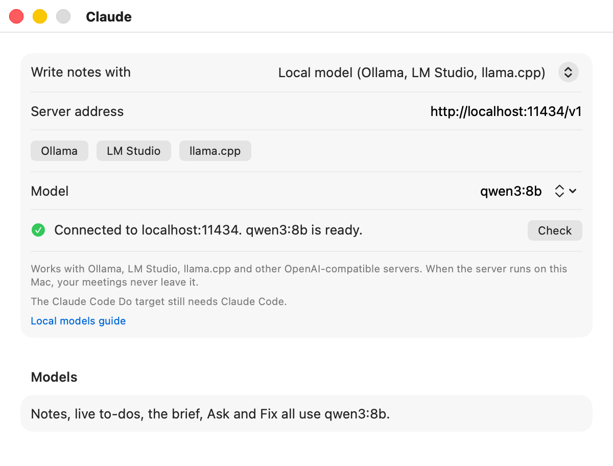

# Local models

Earshot can write notes with a model that runs on your own Mac, through Ollama, LM Studio, llama.cpp or any other server that speaks the OpenAI chat API. Transcription already happens on your Mac, so with a local server the whole meeting stays there.

[Back to the README](../README.md)

## Why use one

- **Privacy.** With the server on this Mac, the transcript and the notes never leave it. Only the Do targets you turn on send anything, as the table below shows.
- **No account.** You don't need Claude Code, a Claude plan or an API key for notes.
- **Offline.** Notes, live to-dos, the brief, Ask and Fix work with no internet connection.

The trade-off is quality and speed. A model that fits on a laptop writes plainer notes than Claude, misses more to-dos, and takes longer. See [Choosing a model](#choosing-a-model).

## What runs locally, and what doesn't

| Feature | With a local model |
|---|---|
| Notes and Fix | Your local model |
| Live to-dos | Your local model |
| The brief and Ask | Your local model |
| The Claude Code Do target | Still runs your Claude Code, with its own sign-in |
| The Claude Code routine target | Still runs in Anthropic's cloud, on your Claude plan |
| Webhook and command targets | Unchanged: they go where you point them |
| AI apps reading your meetings | Unchanged: Claude Code or Claude Desktop sends what it reads to its own provider |

One model does every job. **Settings > Claude** shows "Notes, live to-dos, the brief, Ask and Fix all use" and the model's name, in place of the three Claude model fields.

## Quick setup with Ollama

1. Install [Ollama](https://ollama.com) and open it.
2. Download a model in Terminal:

   ```sh
   ollama pull qwen3:8b
   ```

3. Raise Ollama's context length (see the warning below).
4. In Earshot, open **Settings > Claude** and set **Write notes with** to **Local model (Ollama, LM Studio, llama.cpp)**.
5. Click **Ollama** under **Server address**. It fills in `http://localhost:11434/v1`.
6. Pick `qwen3:8b` from the model list, or type its name.

The status line should say "Connected to localhost:11434. qwen3:8b is ready."

<picture>
  <source media="(prefers-color-scheme: dark)" srcset="images/screens/settings-local-dark.png">
  
</picture>

> [!WARNING]
> Ollama's default context is small, a few thousand tokens. An hour of talk is well over ten thousand, so a long meeting gets cut off unless you raise it. Either start Ollama with a bigger context:
>
> ```sh
> OLLAMA_CONTEXT_LENGTH=32768 ollama serve
> ```
>
> or set the context length in the Ollama app's settings. You can also make a copy of the model with a bigger `num_ctx`: put `FROM qwen3:8b` and `PARAMETER num_ctx 32768` in a file called `Modelfile`, run `ollama create qwen3-32k -f Modelfile`, and pick `qwen3-32k` in Earshot.

When Ollama keeps only part of a long meeting, Earshot notices and stops with "The meeting is longer than the local model's context window." It doesn't write notes from half a meeting.

## LM Studio

1. Install [LM Studio](https://lmstudio.ai) and download a model.
2. Open the **Developer** tab and start the server. It listens on `http://localhost:1234/v1`.
3. Load the model, and set its **Context Length** to 32768 or more when you load it.
4. In Earshot, click **LM Studio** under **Server address**, then pick the model.

## llama.cpp

Start `llama-server` with your model, a big context and the chat template:

```sh
llama-server -m model.gguf --jinja -c 32768 --port 8080
```

In Earshot, click **llama.cpp** under **Server address** (`http://localhost:8080/v1`). `llama-server` lists the model it loaded, so pick that one.

## MLX

`mlx_lm.server` also works:

```sh
mlx_lm.server --model mlx-community/Qwen3-8B-4bit --port 8080
```

It ignores the answer format Earshot asks for (structured outputs). Earshot also puts the format in the prompt, so the model still answers in shape, but small models get it wrong more often. If notes come back in the wrong shape, press **Retry**, or try a bigger model.

## How Earshot talks to the server

- It sends one chat completion at a time to `<address>/chat/completions`, with the format the answer must follow. A server that says it can't do that format gets the same request again without it.
- Live passes are skipped while another call is running, as with Claude. The brief and Ask wait their turn.
- Local models are slow, so the brief and Ask get 5 minutes instead of 1 and 3, and notes and Fix get 10 minutes, as with Claude. A live pass gets 2 minutes; if it runs out, the next pass tries again.
- Checking the server runs only `GET <address>/models`. It never calls a model.
- It never sends an API key, and it never follows a redirect.

## Choosing a model

Pick by how much memory your Mac has:

| Your Mac | Model size | For example |
|---|---|---|
| 16 GB | 8B class | `qwen3:8b`, `llama3.1:8b` |
| 32 GB and up | 12B to 27B class | `gemma3:12b`, `qwen3:14b`, `gpt-oss:20b`, `gemma3:27b` |

Bigger models write better notes and catch more to-dos. They also take longer, and leave less memory for everything else. A bigger context also takes more memory.

## The live assistant on a local model

Each live pass asks the model about the last couple of minutes of talk. A slow model may not finish one pass before the next is due. In **Settings > Live**, set **Check every** to 120 seconds or more. Settings says so when the local model is chosen.

If a pass fails, the panel shows "Couldn't reach the local model; trying at the next check", and the next pass tries again. If the local model isn't set up at all, the panel shows "Paused: the local model isn't set up, check Settings, Claude".

## Privacy

With the server on this Mac, nothing Earshot writes leaves it. Your Do targets and AI apps still send what you give them, as described in [Privacy and consent](privacy-and-consent.md).

The address must be this Mac or your local network unless it uses `https://`. Plain `http://` works for `localhost`, `.local` names and private addresses such as `192.168.1.20`. Anything else needs `https://`, because the transcript would cross the internet. With a server on another machine, the transcript goes to that machine, so use one you trust.

## Troubleshooting

**"Can't reach the local model server".** The server isn't running, or the address is wrong. Start Ollama, LM Studio or `llama-server`, check the port, then click **Check** in **Settings > Claude**.

**"has no chat endpoint. Check that the address ends in /v1."** The address is missing `/v1`. Click one of the buttons under **Server address**, or add `/v1` yourself.

**"The local server has no model named".** The server doesn't have that model, or its name is spelled differently. The status line lists what the server has. With Ollama, run `ollama list`, or `ollama pull` the model. LM Studio and some servers list a model only once it's loaded.

**"The meeting is longer than the local model's context window."** Raise the context: `OLLAMA_CONTEXT_LENGTH` or `num_ctx` for Ollama, **Context Length** in LM Studio, `-c` for llama.cpp. Then press **Retry** on the meeting. A bigger model doesn't help unless its context is bigger too.

**"The local model didn't answer within 5 minutes."** (10 for notes and Fix) The model is too slow for this Mac, or the server is busy with something else. Try a smaller model, or close other apps that use the server. Press **Retry** to try again.

**"The notes came back in the wrong shape".** The model didn't follow the answer format. Press **Retry**. If it keeps happening, use a bigger model, or a server that supports structured outputs (Ollama, LM Studio and llama.cpp all do).

**"asked for an API key".** Earshot's local model setting is for servers that run without a key. Turn the key off in the server, or use a Claude API key in Earshot instead.

**Live to-dos arrive late or not at all.** Raise **Check every** in **Settings > Live**, or use a smaller model.

## Checking it yourself

`earshot doctor` checks the local model first when it is the chosen provider. Its **Local model** line is the same status line Settings shows, and it never calls a model:

```sh
earshot doctor
```

To run the real checks against your own server, build from source and run `make local-test`. It makes real calls to your server with the model you name, in temporary folders only. See [Building from source](building-from-source.md#local-model-tests).

```sh
EARSHOT_LOCAL_URL=http://localhost:11434/v1 EARSHOT_LOCAL_MODEL=qwen3:8b make local-test
```

## Tested setups

Results from `make local-test` for each release. Checks (a) and (c) to (i) are the same notes, live, brief, Ask and Fix
checks that `make claude-test` runs against Claude; (k) runs `earshot process` on a meeting spoken by `say`, so it covers
on-device transcription too.

**0.3.0**, on a Mac Studio (M4 Max, 128 GB) with macOS 26.6.2, October 2026:

| Server | Model | Earshot checks (a, c to i, k) |
|---|---|---|
| Ollama 0.40.4 | `qwen3:8b` | 9 of 9 |
| mlx_lm.server 0.31.3 | Qwen3.8 27B, 4-bit | 9 of 9 (through the schema-in-the-prompt fallback, since this server ignores structured outputs) |
| llama.cpp (build 10090) | Qwen3 8B Q4_K_M | 8 of 9: one to-do left out the person's name |
| Ollama 0.40.4 | `gpt-oss:20b` | 7 of 9: one to-do left out the person's name, and one linked item dropped a keyword the check looks for |

The misses are differences in how the model phrased an answer. Every request, answer and fallback worked on all four.
On the short test meetings, notes took 10 to 24 seconds and a live pass 5 to 9 seconds with the 8B and 20B models; a
long meeting takes longer.

The real app, end to end (`make e2e-import` with a local model): with Qwen3.8 27B it imported a spoken meeting, wrote
the notes and sent the two to-dos the AI can do to a command target. With `qwen3:8b` and `gpt-oss:20b` every step
finished, but on that one-track recording they marked no to-do as AI work, so nothing was sent. Small models pick out
fewer to-dos for the AI.

LM Studio wasn't tested; it serves the same OpenAI-compatible API.
